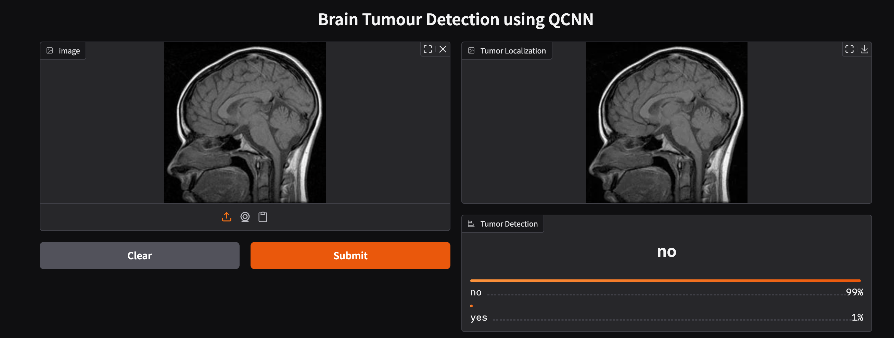

# 🧠 Quantum Brain Tumor Detection

A deep learning project for detecting brain tumors from MRI images using a hybrid quantum-classical neural network. The project combines EfficientNet-B0 for image feature extraction with a variational quantum circuit for classification.

<p align="center">
  
  
  
  
</p>

---

## 📌 Table of Contents

- [Overview](#-overview)
- [Features](#-features)
- [Model Architecture](#-model-architecture)
- [Dataset](#-dataset)
- [Sample Results](#-sample-results)
- [Evaluation](#-evaluation)
- [Technologies Used](#-technologies-used)
- [Project Structure](#-project-structure)
- [Installation and Usage](#-installation-and-usage)
- [Future Improvements](#-future-improvements)
- [Author](#-author)
- [Disclaimer](#-disclaimer)

---

## 🔍 Overview

Brain tumor detection from MRI images is an important application of medical image analysis. This project explores the use of quantum machine learning alongside conventional deep learning to classify brain MRI images into tumor and non-tumor categories.

The system uses a classical convolutional neural network to extract meaningful image features and a quantum circuit to perform additional feature transformations before classification.

The goal is to explore a hybrid approach to image classification and understand how quantum computing techniques can be integrated into machine learning workflows.

## ✨ Features

- 🧠 Brain MRI image classification
- 🔬 Hybrid quantum-classical model
- 🖼️ Image feature extraction using EfficientNet-B0
- ⚛️ Variational quantum circuit using PennyLane
- 📊 Model evaluation using classification metrics
- 💻 Python-based training and prediction scripts
- 🚀 GPU support where compatible hardware and dependencies are available

## 🏗️ Model Architecture

The model combines classical image processing with a quantum machine learning component.

### 1. Image Input and Preprocessing

- Load brain MRI images from the dataset.
- Convert images to grayscale and resize them to the model's required dimensions.
- Normalize image data before feature extraction.

### 2. Classical Feature Extraction

EfficientNet-B0 extracts useful visual features from the MRI images. A feature-compression layer prepares these features for quantum encoding.

### 3. Quantum Feature Processing

The quantum component uses PennyLane to implement a variational quantum circuit.

- Four-qubit quantum circuit
- Angle embedding for feature encoding
- Strongly entangling layers for parameterized quantum operations

### 4. Classification

The extracted and transformed features are passed to the output layer to generate a tumor or non-tumor prediction.

### Architecture Flow

```text
Brain MRI Image
       |
       v
Image Preprocessing
(Grayscale, Resize, Normalize)
       |
       v
EfficientNet-B0
(Feature Extraction)
       |
       v
Feature Compression
       |
       v
Quantum Feature Encoding
       |
       v
Variational Quantum Circuit
       |
       v
Classification Layer
       |
       v
Tumor / No Tumor
```

## 📂 Dataset

This project uses the publicly available Brain MRI dataset hosted on Kaggle.

**Dataset Link:** 
[ https://www.kaggle.com/datasets/skarthik112/karthik-braindataset-mri ]

The dataset contains MRI images organized into tumor and non-tumor categories.

### Dataset Classes

| Class | Description |
|---|---|
| `yes` | MRI images with a tumor |
| `no` | MRI images without a tumor |

### Dataset Setup

1. Open the Kaggle dataset link above.
2. Download the dataset.
3. Extract the downloaded files.
4. Configure the dataset path according to the training script.
5. Verify that the folder structure matches the format expected by the code.

The dataset is not included in this repository. Please refer to the original Kaggle page for the dataset and its usage terms.


## 🖼️ Sample Results

### Tumor Detected


### No Tumor Detected




> **Note:** The image paths above are examples. Upload your actual screenshots using the same filenames, or update the paths to match your files.

## 📊 Evaluation

The model can be evaluated using the following metrics:

- Accuracy
- Precision
- Recall
- F1-score
- Confusion matrix

Add your actual evaluation results after running the model.

| Metric | Result |
|---|---|
| Accuracy | Add measured result |
| Precision | Add measured result |
| Recall | Add measured result |
| F1-score | Add measured result |

Performance depends on the dataset split, training configuration, and model initialization. No performance figures are claimed here.

## 🛠️ Technologies Used

| Technology | Purpose |
|---|---|
| Python | Main programming language |
| PyTorch | Deep learning framework |
| Torchvision | Image processing and EfficientNet-B0 |
| PennyLane | Quantum machine learning |
| NumPy | Numerical computation |
| OpenCV | Image processing utilities |
| Gradio | Prediction interface, if configured in the application |

## 📁 Project Structure

```text
brain_tumor_detection/
│
├── train_qcnn.py       # Model training
├── predict_qcnn.py     # Prediction interface
├── requirements.txt    # Python dependencies
├── README.md           # Project documentation
├── LICENSE             # License information
│
└── assets/
    ├── yes_result.png  # Example tumor prediction
    └── no_result.png  # Example non-tumor prediction
```

The `assets/` directory is optional. Create it and add your screenshots if you want them displayed in the README.

## 🚀 Installation and Usage

### Prerequisites

- Python installed on your system
- Git
- pip
- A compatible environment for PyTorch and PennyLane

### 1. Clone the Repository

```bash
git clone https://github.com/akhiladega/brain_tumor_detection.git
cd brain_tumor_detection
```

### 2. Install Dependencies

```bash
pip install -r requirements.txt
```

### 3. Download and Configure the Dataset

Download the [Kaggle Brain MRI dataset](https://www.kaggle.com/datasets/skarthik112/karthik-braindataset-mri) and configure the path expected by the training script.

### 4. Train the Model

```bash
python train_qcnn.py
```

### 5. Run Predictions

```bash
python predict_qcnn.py
```

Follow the application's instructions to test an MRI image.

## 🔮 Future Improvements

- Improve model evaluation using a separate test dataset.
- Add visualizations for training and validation performance.
- Include a confusion matrix and classification report.
- Improve the prediction interface and user experience.
- Explore explainability techniques for model predictions.
- Evaluate generalization using additional MRI datasets.

## 👩‍💻 Author

**Akhiladega**

Computer Science Engineering Student

GitHub: [@akhiladega](https://github.com/akhiladega)

Project Repository: [Brain Tumor Detection](https://github.com/akhiladega/brain_tumor_detection)

---

## ⚠️ Disclaimer

This project is intended for educational and research purposes. Its predictions are not a substitute for professional medical evaluation, diagnosis, or treatment.

